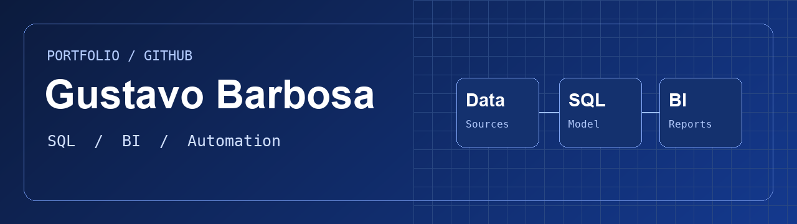
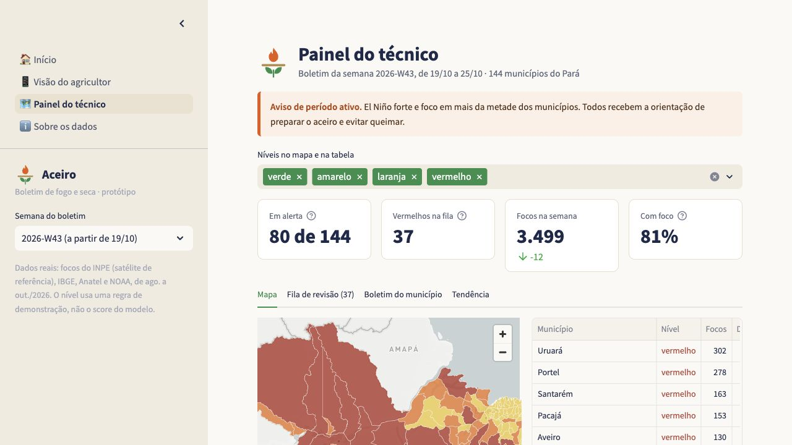

[**Portfolio**](https://gustavo-barbosa-data-portfolio.rocky-wave-5547.chatgpt.site/?lang=en) · [**LinkedIn**](https://www.linkedin.com/in/gustavo-de-araujo-barbosa/) · [**Português**](https://github.com/gustavo-araujo-barbosa/gustavo-araujo-barbosa/blob/main/README.pt-BR.md)

I build and validate SQL datasets, automate financial reporting, and maintain KPI dashboards at Skyone.

## Projects

### Aceiro · Fire and drought monitoring in Pará

A Streamlit prototype built with Jonatas Menezes that turns public fire and drought data into weekly bulletins for **144 municipalities**. I prepared the public datasets, implemented the prototype’s alert rule, and built the technician’s dashboard.

**Python · Pandas · Streamlit · PyDeck**

[**Source code**](https://github.com/gustavo-araujo-barbosa/aceiro-painel) · [**Open demo**](https://aceiro-para.streamlit.app/)

### Finance Data Hub · Financial data workflows

Personal project in development. The goal is to trace each analysis back to a public financial statement from Brazil’s CVM and the rules used to transform it.

**Python · DuckDB · dbt · Streamlit · Docker** · SQL planned

[**Read about the project**](https://gustavo-barbosa-data-portfolio.rocky-wave-5547.chatgpt.site/?lang=en#finance-data-hub)

## Applied at work

**Skyone.** Built 10+ financial reporting automations. I work with SQL views in SAP HANA, Excel and Power Query, and maintain automated Power BI dashboards for financial KPIs. [Read the case](https://gustavo-barbosa-data-portfolio.rocky-wave-5547.chatgpt.site/?lang=en#skyone).
