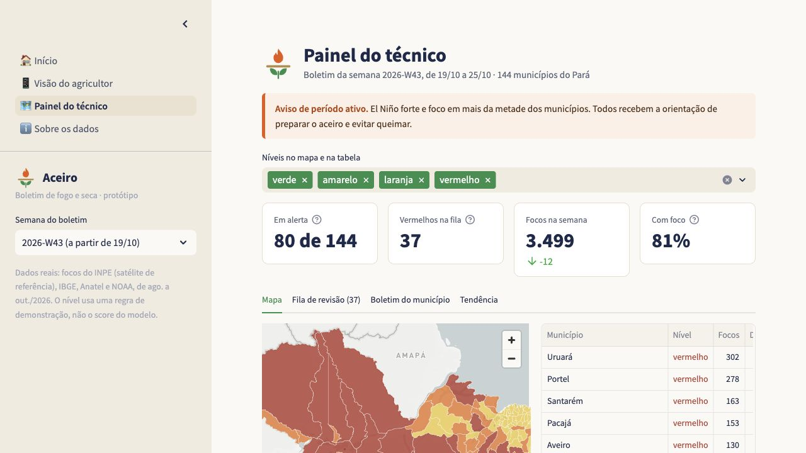
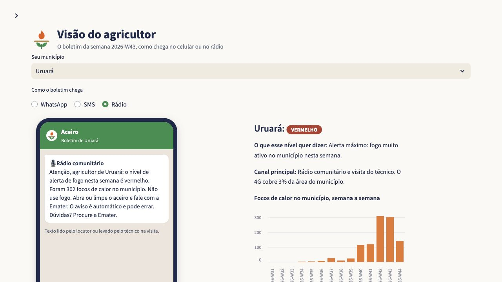

  <strong>FP&A Analyst at Skyone · Accounting graduate · Data Science student at FIAP</strong> 
  <a href="https://www.linkedin.com/in/gustavo-de-araujo-barbosa/">LinkedIn</a> ·
  <a href="https://github.com/gustavo-araujo-barbosa/gustavo-araujo-barbosa/blob/main/README.pt-BR.md">Português</a>

I work with financial data and reporting automation. Here I share personal and academic projects, the problems behind them and how they are built.

## Selected projects

### Aceiro · Public data for local decisions

An academic team project exploring how public data on fire activity and drought can support family farmers in Pará, Brazil.

- **The problem:** making technical information easier to understand at municipal level.
- **The prototype:** a farmer's bulletin, a technician's dashboard and an explanation of the data and demonstration rules.
- **The team:** Raiz de Dados · FIAP Global Solution 2026/2. Team credits are in the project README.

**Python · Pandas · Streamlit · PyDeck**

[Explore the project, sources and local setup →](https://github.com/gustavo-araujo-barbosa/aceiro-painel)

See the farmer's view and prototype notes

Screens captured from the actual application, using its public data. This is an academic prototype: message delivery is simulated, and the dashboard has not been validated with farmers or field technicians. The alert level uses a demonstration rule, not the project's separately tested statistical model.

### Finance Data Hub · Financial analytics and data workflows

**Personal project · In development**

Organizing financial data so that analyses can be traced back to their sources and transformation rules. The project includes work with public financial statements from Brazil's CVM and a local application using synthetic data.

**Python · DuckDB · dbt · Streamlit**

The repository is private. A public case study is being prepared.

## Where finance meets implementation

At Skyone, I build and validate SQL views in SAP HANA, automate reporting workflows with Excel and Power Query, and maintain financial KPI dashboards in Zoho Analytics. Earlier, at Itaú Unibanco, I built a Power BI dashboard for the team's workload reporting.

My professional focus is financial data and automation. My personal projects are a place to develop and demonstrate broader data skills.

[More about my professional experience on LinkedIn →](https://www.linkedin.com/in/gustavo-de-araujo-barbosa/)
