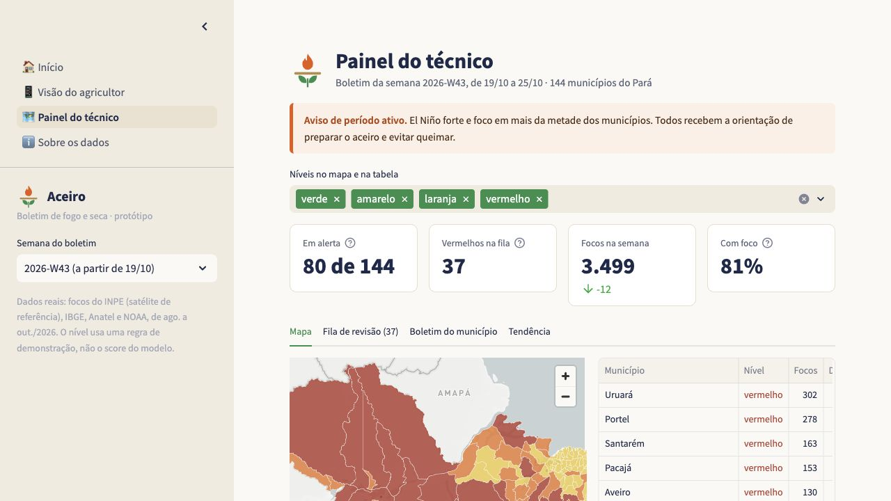
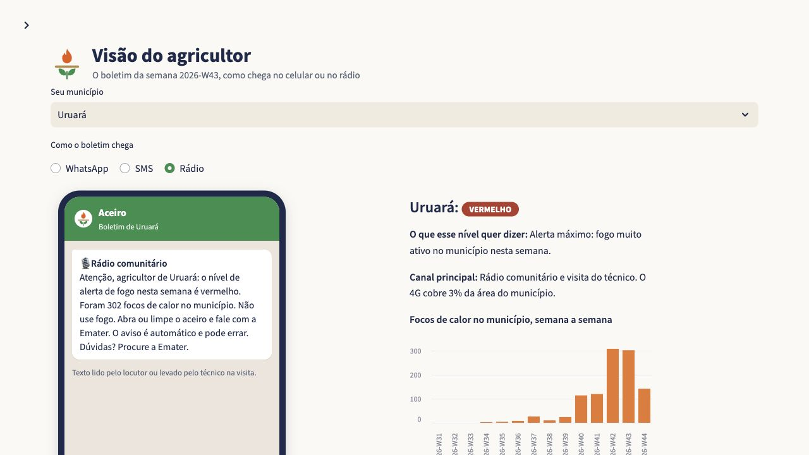

  <strong>Analista de FP&A na Skyone · Formado em Ciências Contábeis · Estudante de Data Science na FIAP</strong> 
  <a href="https://www.linkedin.com/in/gustavo-de-araujo-barbosa/">LinkedIn</a> ·
  <a href="https://github.com/gustavo-araujo-barbosa/gustavo-araujo-barbosa/blob/main/README.md">English</a>

Trabalho com dados financeiros e automação de relatórios. Aqui compartilho projetos pessoais e acadêmicos, os problemas que motivaram cada um e como eles são construídos.

## Projetos em destaque

### Aceiro · Dados públicos para decisões locais

Projeto acadêmico em equipe que explora como dados públicos de focos de calor e seca podem apoiar a agricultura familiar do Pará.

- **O problema:** facilitar a compreensão de informações técnicas por município.
- **O protótipo:** boletim para o agricultor, painel do técnico e explicação dos dados e das regras de demonstração.
- **A equipe:** Raiz de Dados · FIAP Global Solution 2026/2. Os créditos estão no README do projeto.

**Python · Pandas · Streamlit · PyDeck**

[Explorar projeto, fontes e instruções de execução →](https://github.com/gustavo-araujo-barbosa/aceiro-painel)

Ver a visão do agricultor e as notas do protótipo

Capturas da aplicação real, com os dados públicos do projeto. É um protótipo acadêmico: o envio de mensagens é simulado, e o painel ainda não foi validado com agricultores ou técnicos de campo. O nível de alerta usa uma regra de demonstração, não o modelo estatístico testado à parte no projeto.

### Finance Data Hub · Análise financeira e fluxos de dados

**Projeto pessoal · Em desenvolvimento**

Organização de dados financeiros para que as análises possam ser rastreadas até suas fontes e regras de transformação. O projeto inclui uma frente com demonstrações financeiras públicas da CVM e uma aplicação local com dados sintéticos.

**Python · DuckDB · dbt · Streamlit**

O repositório é privado. O estudo de caso público está em preparação.

## Finanças na prática, com dados

Na Skyone, construo e valido views SQL no SAP HANA, automatizo fluxos de relatórios com Excel e Power Query e mantenho dashboards de indicadores financeiros no Zoho Analytics. Antes, no Itaú Unibanco, desenvolvi um dashboard em Power BI para acompanhar as demandas do time.

Meu foco profissional é dados financeiros e automação. Os projetos pessoais são um espaço para desenvolver e demonstrar outras competências em dados.

[Mais sobre minha trajetória profissional no LinkedIn →](https://www.linkedin.com/in/gustavo-de-araujo-barbosa/)
