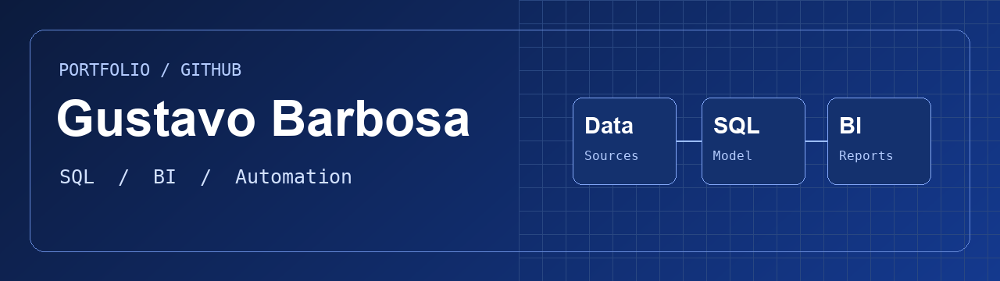
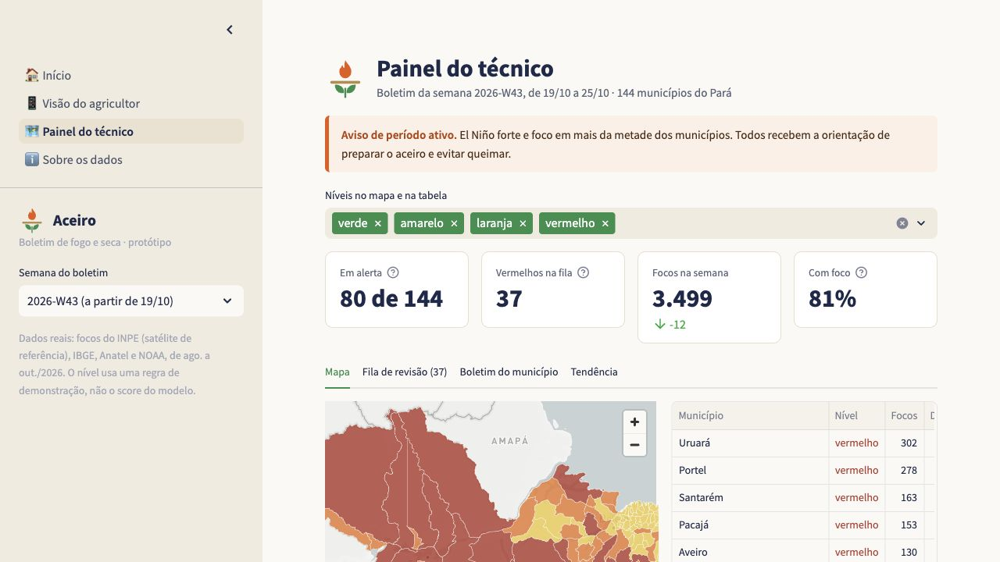

[**Portfólio**](https://gustavo-araujo-barbosa.github.io) · [**LinkedIn**](https://www.linkedin.com/in/gustavo-de-araujo-barbosa/) · [**English**](https://github.com/gustavo-araujo-barbosa/gustavo-araujo-barbosa)

Na Skyone, crio e valido bases em SQL, automatizo relatórios financeiros e mantenho dashboards de indicadores.

## Projetos

### Aceiro · Monitoramento de fogo e seca no Pará

Protótipo em Streamlit desenvolvido em dupla com Jonatas Menezes. Transforma dados públicos de fogo e seca em boletins semanais para **144 municípios**. Preparei as bases públicas, implementei a regra de alerta do protótipo e construí o painel do técnico.

**Python · Pandas · Streamlit · PyDeck**

[**Código-fonte**](https://github.com/gustavo-araujo-barbosa/aceiro-painel) · [**Abrir demonstração**](https://aceiro-para.streamlit.app/)

### Finance Data Hub · Fluxos de dados financeiros

Projeto pessoal em desenvolvimento. O objetivo é rastrear cada análise até a demonstração financeira pública da CVM e às regras usadas para transformar os dados.

**Python · DuckDB · dbt · Streamlit · Docker** · SQL previsto

[**Conhecer o projeto**](https://gustavo-araujo-barbosa.github.io/#finance-data-hub)

## Aplicação profissional

**Skyone.** Criei 10+ automações de relatórios financeiros. Trabalho com views SQL no SAP HANA, Excel e Power Query e mantenho dashboards automatizados de indicadores financeiros no Power BI. [Conhecer o caso](https://gustavo-araujo-barbosa.github.io/#skyone).
